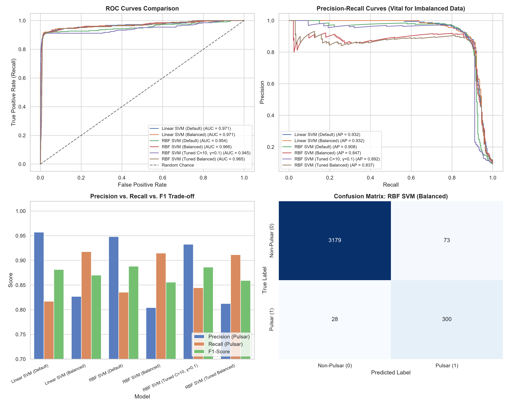

# Pulsar Star Classification with Support Vector Machines (SVM)

[](https://www.python.org/)
[](https://scikit-learn.org/)
[](https://opensource.org/licenses/MIT)

Predicting rare pulsar candidates from radio astronomy telescope signals using **Support Vector Machines (SVM)** on the HTRU2 benchmark dataset.

---

## Table of Contents
- [Background & Problem Context](#background--problem-context)
- [Dataset Overview](#dataset-overview)
- [Methodology & SVM Modeling](#methodology--svm-modeling)
- [Experimental Results](#experimental-results)
- [Diagnostic Plots](#diagnostic-plots)
- [Project Structure](#project-structure)
- [Installation & Quickstart](#installation--quickstart)
- [Inference & Predictions](#inference--predictions)
- [References & Acknowledgments](#references--acknowledgments)

---

## Background & Problem Context

Pulsars are rapidly rotating, highly magnetized neutron stars that emit directional beams of electromagnetic radiation. When these beams sweep past Earth, radio telescopes detect periodic pulses. 

In large-scale radio surveys, telescope automated pipelines extract millions of candidate signals. However, the overwhelming majority (>90%) are false alarms caused by **Radio Frequency Interference (RFI)**, terrestrial noise, or instrumentation anomalies. Identifying genuine pulsar signals manually is infeasible.

This project implements and evaluates **Support Vector Machines (SVM)** to automate candidate screening, handling strong class imbalance and non-linear feature distributions.

---

## Dataset Overview

The dataset is derived from the **HTRU2 (High Time Resolution Universe Survey)** and available on Kaggle at [Pulsar Classification for Class Prediction](https://www.kaggle.com/datasets/brsdincer/pulsar-classification-for-class-prediction/data).

* **Total Samples:** 17,898
* **Feature Count:** 8 continuous numerical features
* **Missing Values:** 0 (clean dataset)
* **Target Classes:**
  * **Class 0 (Non-Pulsar / Noise / RFI):** 16,259 instances (**90.84%**)
  * **Class 1 (True Pulsar Candidate):** 1,639 instances (**9.16%**)
  * **Imbalance Ratio:** $\approx 9.9 : 1$

### Features Description
For every candidate signal, 4 statistical moments (mean, standard deviation, excess kurtosis, and skewness) are calculated across two curves:

| Feature Name | Description | Correlation with Target |
| :--- | :--- | :---: |
| `Mean_Integrated` | Mean of the integrated pulse profile | -0.6732 |
| `SD` | Standard deviation of the integrated pulse profile | -0.3637 |
| `EK` | Excess kurtosis of the integrated pulse profile | **+0.7916** |
| `Skewness` | Skewness of the integrated pulse profile | **+0.7095** |
| `Mean_DMSNR_Curve` | Mean of the DM-SNR curve | +0.4009 |
| `SD_DMSNR_Curve` | Standard deviation of the DM-SNR curve | +0.4915 |
| `EK_DMSNR_Curve` | Excess kurtosis of the DM-SNR curve | -0.3908 |
| `Skewness_DMSNR_Curve`| Skewness of the DM-SNR curve | -0.2591 |

---

## Methodology & SVM Modeling

### 1. Preprocessing & Scaling
SVM seeks the maximum margin hyperplane based on Euclidean distances in feature space:
$$\min_{\mathbf{w}, b, \boldsymbol{\xi}} \frac{1}{2} \|\mathbf{w}\|^2 + C \sum_{i=1}^n \xi_i$$
Because features span vastly different scales (e.g., `EK` $\in [-1.88, 8.07]$ vs. `Skewness_DMSNR_Curve` $\in [-3.14, 1191.0]$), **StandardScaler** ($z = \frac{x - \mu}{\sigma}$) is fitted strictly on the training set and applied across both train and test splits.

### 2. Handling Class Imbalance
In astronomical candidate filtering, missing a true pulsar (False Negative) is substantially worse than reviewing extra false candidates (False Positive). We combat the 9.9:1 majority class bias using cost-sensitive learning:
$$w_c = \frac{N}{2 \times N_c}$$
Assigning higher loss penalties to the minority class pulls the decision boundary toward the majority class, drastically boosting recall.

### 3. Kernel Exploration & Tuning
We evaluate:
- **Linear Kernel:** Fast, interpretable benchmark.
- **Radial Basis Function (RBF) Kernel:** $K(\mathbf{x}, \mathbf{x}') = \exp(-\gamma \|\mathbf{x} - \mathbf{x}'\|^2)$, capturing non-linear interactions.
- **Hyperparameter Grid Search:** 5-fold Stratified Cross-Validation over regularization $C$, kernel coefficient $\gamma$, and class weight schemes.

---

## Experimental Results

Evaluated on an **80/20 Stratified Test Set** (3,580 samples: 3,252 Non-Pulsars, 328 Pulsars):

| Model | Accuracy | Precision (Pulsar) | Recall (Pulsar) | F1-Score | ROC-AUC | PR-AUC | TP | FP | FN |
| :--- | :---: | :---: | :---: | :---: | :---: | :---: | :---: | :---: | :---: |
| **Linear SVM (Default)** | 97.99% | **95.71%** | 81.71% | 0.8816 | 0.9706 | 0.9320 | 268 | 12 | 60 |
| **Linear SVM (Balanced)** | 97.49% | 82.69% | **91.77%** | 0.8699 | **0.9708** | **0.9318** | 301 | 63 | 27 |
| **RBF SVM (Default)** | **98.07%** | 94.81% | 83.54% | **0.8882** | 0.9542 | 0.9080 | 274 | 15 | 54 |
| **RBF SVM (Balanced)** | 97.18% | 80.43% | **91.46%** | 0.8559 | 0.9661 | 0.8468 | 300 | 73 | **28** |
| **RBF SVM (Tuned $C=10, \gamma=0.1$)** | 98.02% | 93.27% | 84.45% | 0.8864 | 0.9452 | 0.8920 | 277 | 20 | 51 |
| **RBF SVM (Tuned Balanced)** | 97.26% | 81.25% | 91.16% | 0.8592 | 0.9649 | 0.8368 | 299 | 69 | 29 |

### Key Takeaways
1. **Recall vs. Precision Trade-off:** Standard SVM achieves higher overall precision (~95%), but misses 54 true pulsars. With `class_weight='balanced'`, recall surges from **83.5% to 91.5%+**, cutting missed pulsars in half (down to 27-28).
2. **ROC-AUC & PR-AUC:** Both Linear and RBF models demonstrate strong discriminative separation, exceeding **0.97 ROC-AUC** and **0.93 PR-AUC**.

---

## Diagnostic Plots

All diagnostic curves and matrix breakdowns are generated and saved by the training pipeline:



1. **ROC Curves:** Illustrates True Positive Rate vs False Positive Rate across all thresholds.
2. **Precision-Recall Curves:** Crucial indicator under heavy class imbalance, highlighting the high area under precision-recall.
3. **Precision vs. Recall vs. F1 Bar Chart:** Clear visualization of the trade-off induced by class re-weighting.
4. **Confusion Matrix:** True Positives vs False Negatives under balanced SVM.

---

## Project Structure

```
pulsarsvm/
├── Pulsar.csv                  # Dataset (HTRU2 pulsar candidates)
├── requirements.txt            # Python dependencies
├── train_svm.py                # Model training, evaluation & plotting pipeline
├── predict.py                  # Standalone CLI inference script
├── svm_pulsar_pipeline.joblib  # Serialized trained model pipeline
├── svm_pulsar_evaluation.png   # Diagnostic evaluation plots
├── .gitignore                  # Git ignore rules
└── README.md                   # Project documentation
```

---

## Installation & Quickstart

### 1. Clone the repository
```bash
git clone https://github.com/azizisoroush/pulsarsvm.git
cd pulsarsvm
```

### 2. Set up virtual environment & install requirements
```bash
python -m venv venv
# On Linux/macOS:
source venv/bin/activate
# On Windows:
venv\Scripts\activate

pip install -r requirements.txt
```

### 3. Train the models
```bash
python train_svm.py
```
This executes data loading, exploratory checks, stratified training, evaluations, updates the diagnostic plot (`svm_pulsar_evaluation.png`), and serializes the best model (`svm_pulsar_pipeline.joblib`).

---

## Inference & Predictions

Run predictions on sample signals:
```bash
python predict.py --n-samples 5
```

Sample output:
```
======================================================================
PULSAR DETECTION INFERENCE
======================================================================
Loaded Model: RBF SVM (Balanced)
Features: Mean_Integrated, SD, EK, Skewness, Mean_DMSNR_Curve, SD_DMSNR_Curve, EK_DMSNR_Curve, Skewness_DMSNR_Curve

Testing on 10 sample candidates from Pulsar.csv...

----------------------------------------------------------------------
 Mean_Integrated        EK  Skewness  Mean_DMSNR_Curve  Class  SVM_Decision_Score         Prediction_Label
       71.476562  1.637756  5.393194         13.479933      1            2.001981       🌟 PULSAR CANDIDATE
       15.617188  4.038129 15.771687        101.582776      1            1.051230       🌟 PULSAR CANDIDATE
       38.554688  4.014319 18.684600         35.036789      1            1.197938       🌟 PULSAR CANDIDATE
      134.500000 -0.021246  0.107623          0.747492      0           -1.041295 Non-Pulsar (Noise / RFI)
      117.039062 -0.005206 -0.344231          1.622910      0           -1.141516 Non-Pulsar (Noise / RFI)
----------------------------------------------------------------------

Correct Predictions on sample: 10/10 (100.0%)
```

---

## References & Acknowledgments

- **Dataset:** [Pulsar Classification for Class Prediction](https://www.kaggle.com/datasets/brsdincer/pulsar-classification-for-class-prediction/data) on Kaggle.
- **Original Survey Paper:** Lyon, R. J. et al. (2016). *Fifty Years of Pulsar Candidate Selection: From simple filters to a new Machine Learning horizon*, Monthly Notices of the Royal Astronomical Society (MNRAS).
- Built with [scikit-learn](https://scikit-learn.org/), [pandas](https://pandas.pydata.org/), and [matplotlib](https://matplotlib.org/).
